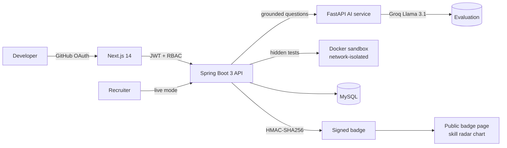

<div align="center">
  
</div>

<br/>

<div align="center">

**Java / Spring Boot backend developer · B.Tech CSE, REVA University '27 · CGPA 8.5**

[Case files](#-case-files) · [Stack](#-stack-by-layer) · [Live data](#-live-from-my-github) · [Milestones](#-milestones) · [Contact](#-lets-talk)

<!--START_STATS-->
*Stats appear after the first workflow run.*
<!--END_STATS-->

</div>

---

## 👋 About

I build backend systems and I assume someone will try to abuse them. That habit comes from experience: the first version of my capstone was beaten by generic AI-written answers, and fixing it taught me more than any tutorial.

```yaml
name:        Gowtham M S
based_in:    Karnataka, India
studying:    B.Tech Computer Science, REVA University (2023-2027), CGPA 8.5/10
target_role: Java Spring Boot backend / DevOps
core_stack:  Java, Spring Boot, Python, FastAPI, Next.js, Docker, MySQL
how_i_learn: build first, read the docs when it breaks
open_to:     internships and entry-level backend / DevOps roles
```

---

## 🗄️ Case files

Every project below is written as a case: the problem, what I did, what it runs on, and its honest status. **Shipped** means the code is on my GitHub. **Designed** means documented but not built yet.

### 🛡️ Case 001: SkillProof `SHIPPED` `FLAGSHIP`

> **Resumes are claims. SkillProof makes them evidence.**

**Problem.** Anyone can write "Java expert" on a resume. Recruiters have no cheap way to check. And once I added AI evaluation, a second problem appeared: generic AI-written answers scored too high on my own platform.

**What it does.** GitHub OAuth → analyses your actual code → asks questions grounded in *your* repository → runs your code in a sandbox → issues a signed badge anyone can verify.



**The threat model.**

| Attack | Defense |
|---|---|
| Generic answers that sound right | Questions grounded in the candidate's own repository, plus prompt constraints that harden the evaluator |
| Pasting an answer without writing code | Docker sandbox that runs code against **hidden test cases** |
| Calling out from inside the sandbox | Network isolation |
| Forging a result | **HMAC-SHA256** signed badge tokens, public badge page |

**Features:** GitHub OAuth · JWT + role-based access control · recruiter live mode · public badge page with skill radar chart · Jitsi-based live pair programming.

**Stack:** Java 21 · Spring Boot 3 · Python FastAPI (isolated AI service) · Groq Llama 3.1 · Next.js 14 · MySQL · Docker

<details>
<summary><b>🔍 How signed badges are verified (simplified, illustrative)</b></summary>

```java
// A badge is only valid if its signature matches the payload.
// Compare in constant time so the check itself leaks nothing.
boolean verify(String payload, byte[] signature, SecretKey key) throws Exception {
    Mac mac = Mac.getInstance("HmacSHA256");
    mac.init(key);
    byte[] expected = mac.doFinal(payload.getBytes(StandardCharsets.UTF_8));
    return MessageDigest.isEqual(expected, signature);
}
```

Change one character in the payload and verification fails. That's the whole point.
</details>

[](https://github.com/Gowtham232004/Skill_Proof)

> 🧨 **Think you can get a generic answer past it?** Open an issue on [Skill_Proof](https://github.com/Gowtham232004/Skill_Proof/issues). Breaking it is the best feedback I can get.

---

### 🔎 Case 002: GitHub Auditor `ON GITHUB`

A Python backend ([`github-auditor`](https://github.com/Gowtham232004/github-auditor)) paired with a TypeScript frontend ([`github-auditor-frontend`](https://github.com/Gowtham232004/github-auditor-frontend)). Details are in each repository.

---

### 📈 Case 003: PipelineIQ `DESIGNED`

**Problem.** CI/CD failures eat developer time, and most tools tell you *that* a build failed, not *what keeps failing and why*.

**Design.** A developer productivity intelligence platform with five pillars: **Pipeline Health Score**, **Failure Pattern Intelligence**, **Commit Risk Scoring**, **Repository Fragility Index** and a **Weekly AI Digest**.

**Why it's here.** It started as an over-scoped idea. I cut it down to a version I could actually build, and the full documentation is written. It isn't implemented yet and I'm saying so.

---

### 🏠 Case 004: RentSahay `DESIGNED`

**Problem.** Rental agreements are long, legal and different in every state, and tenants often sign without understanding them.

**Design.** An AI platform that analyses a rental agreement against **state-specific Indian rent law**, using **RAG** over a ChromaDB knowledge base with Google Gemini. Two versions of formal documentation are written. It isn't implemented yet.

---

### 🏁 Case 005: Hackathon builds `TEAM`

Team projects built under time pressure at the **24-hour AutoML Hackathon (REVA University)** and the **Solaris X Grand Hackathon (RNSIT Luminus 2026)**.

---

## 🧰 Stack by layer

| Layer | What I use |
|---|---|
| **Backend** | Java 21 · Spring Boot 3 · Python · FastAPI |
| **Frontend** | Next.js · React · TypeScript |
| **Data** | MySQL · ChromaDB |
| **Security** | JWT · RBAC · HMAC-SHA256 · Docker sandboxing |
| **DevOps** | Docker · GitHub Actions |
| **AI integration** | Groq (Llama 3.1) · Google Gemini · RAG |

<div align="center">


</div>

---

## 📡 Live from my GitHub

Everything in this section is generated by a GitHub Action every 6 hours. Forks are excluded, so it's all my own code.

### 🗂️ Every repo I've built

<!--START_PROJECTS-->
*Waiting for the first workflow run...*
<!--END_PROJECTS-->

### 🧬 Code DNA

<!--START_DNA-->
*Waiting for the first workflow run...*
<!--END_DNA-->

### 🧾 Latest commits

<!--START_COMMITS-->
*Waiting for the first workflow run...*
<!--END_COMMITS-->

---

## 🏆 Milestones

| | |
|---|---|
| 🏁 **Hackathons** | Participated in 2: Solaris X Grand Hackathon (RNSIT Luminus 2026) and a 24-hour AutoML Hackathon (REVA University) |
| 🌍 **Open source** | Selected as a **GSSoC 2026** contributor |
| 🦈 **GitHub** | **Pull Shark** achievement, awarded by GitHub for merged pull requests |
| 🎓 **Academics** | B.Tech CSE at REVA University, CGPA **8.5 / 10** |
| 🛠️ **Capstone** | SkillProof: full-stack, multi-service, with a real threat model |

---

## 🧭 How I build

1. **Threat-model first.** Ask who benefits from breaking it, then design for that person.
2. **Isolate what you don't trust.** The AI service runs separately from the core API, and user code runs in a network-isolated sandbox.
3. **Make results verifiable.** A claim without a signature is just text.
4. **Cut scope honestly.** PipelineIQ shrank from a huge idea to five buildable pillars. Marking projects "designed" instead of "shipped" is part of the same habit.

---

## 🤝 Let's talk

I'm looking for **Java / Spring Boot backend and DevOps** internships and entry-level roles. If you want to talk about designing systems that resist abuse, say hi.

<div align="center">

[](https://www.linkedin.com/in/YOUR-LINKEDIN/)
[](mailto:YOUR-EMAIL@example.com)
[](https://github.com/Gowtham232004)

</div>
