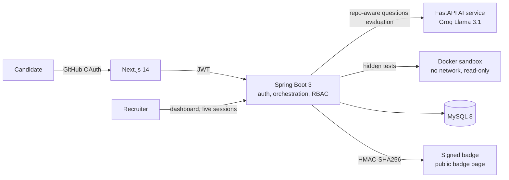
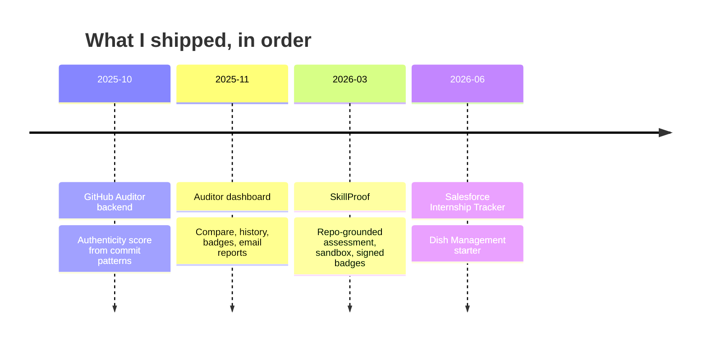

<div align="center">
  
</div>

<br/>

<div align="center">

**Most profiles say what the developer knows. This one links to the code that proves it.**

[Proof in 60 seconds](#-proof-in-60-seconds) · [Case files](#-case-files) · [Build log](#-build-log) · [Stack with receipts](#-stack-with-receipts) · [Live data](#-live-from-my-github) · [Contact](#-lets-talk)

<!--START_STATS-->
*Stats appear after the first workflow run.*
<!--END_STATS-->

</div>

---

## ⚡ Proof in 60 seconds

Each row is a claim and the exact place in the code where you can check it.

| I claim | Check it yourself |
|---|---|
| Untrusted code runs with **no network, a read-only filesystem, 1 CPU, a 128-process cap** | [`DockerExecutionService.java`](https://github.com/Gowtham232004/Skill_Proof/blob/main/backend-core/src/main/java/com/skillproof/backend_core/service/DockerExecutionService.java#L165-L190) |
| Badges are **HMAC-SHA256** tokens over `userId : repo : score : timestamp`, so editing any field invalidates them | [`HmacUtil.java`](https://github.com/Gowtham232004/Skill_Proof/blob/main/backend-core/src/main/java/com/skillproof/backend_core/util/HmacUtil.java#L14-L40) |
| Auth is **GitHub OAuth + JWT** with role enforcement | [`JwtAuthFilter.java`](https://github.com/Gowtham232004/Skill_Proof/blob/main/backend-core/src/main/java/com/skillproof/backend_core/config/JwtAuthFilter.java) · [`SecurityConfig.java`](https://github.com/Gowtham232004/Skill_Proof/blob/main/backend-core/src/main/java/com/skillproof/backend_core/config/SecurityConfig.java) |
| Candidate answers carry **integrity telemetry**: tab switches, paste count, answer timing, stored with the badge | [`SubmitAnswersRequest.java`](https://github.com/Gowtham232004/Skill_Proof/blob/main/backend-core/src/main/java/com/skillproof/backend_core/dto/request/SubmitAnswersRequest.java) · [`Badge.java`](https://github.com/Gowtham232004/Skill_Proof/blob/main/backend-core/src/main/java/com/skillproof/backend_core/model/Badge.java) |
| I **test** the trust logic: badges, verification, live sessions, confidence tiers, recruiter endpoints | [`src/test`](https://github.com/Gowtham232004/Skill_Proof/tree/main/backend-core/src/test/java/com/skillproof/backend_core) (8 test classes) |
| I found hard-coded secrets in my own config on day 3 and removed them | [commit `8be4efa`](https://github.com/Gowtham232004/Skill_Proof/commit/8be4efa) |
| A second system detects **7 kinds of suspicious commit patterns** | [`git_analyzer.py`](https://github.com/Gowtham232004/github-auditor/blob/main/git_analyzer.py#L195-L277) |
| Public endpoints are **rate limited per IP** | [`rate_limiter.py`](https://github.com/Gowtham232004/github-auditor/blob/main/rate_limiter.py) |

---

## 🗄️ Case files

Each case lists the problem, what I built, my role and an honest status.

### 🛡️ Case 001 · SkillProof `WORKING` `FLAGSHIP`

> **Resumes are claims. SkillProof makes them evidence.**

| | |
|---|---|
| **Problem** | Resumes and portfolios are easy to inflate, and once AI evaluates answers, generic AI-written answers can look convincing. In my first version they scored too high. |
| **What it does** | GitHub OAuth → repo ingestion → questions grounded in *your* code → AI evaluation with a rubric and guardrails → confidence tier → signed badge. Recruiters get a dashboard with evidence, decisions (`VERIFIED`, `NEEDS_LIVE_INTERVIEW`, `REJECT`), candidate compare, live validation sessions and Jitsi video rooms. Coding challenges run against hidden tests in a Docker sandbox. |
| **Size** | About 13,000 lines of Java across 101 files, 2,000 lines of Python, 9,000 lines of TypeScript, 43 REST endpoints (by mapping annotation count), 92 commits |
| **My role** | Team of 3. I wrote the large majority of `backend-core`, `backend-ai` and the frontend (`git shortlog` shows it). Teammates handled documentation, weekly reports and parts of the frontend. |
| **Stack** | Java 21 · Spring Boot 3 · FastAPI (Python 3.11) · Groq Llama 3.1 · Next.js 14 · TypeScript · MySQL 8 · Docker |
| **Timeline** | 19 Mar 2026 → 25 Apr 2026 |
| **Status** | Runs locally across three services. No public deployment linked, no CI yet. See [what's next](#-whats-next). |



**The real badge token logic**, straight from [`HmacUtil.java`](https://github.com/Gowtham232004/Skill_Proof/blob/main/backend-core/src/main/java/com/skillproof/backend_core/util/HmacUtil.java):

```java
// Token = HMAC-SHA256(secret, userId + repoName + score + timestamp)
// Any tampering with badge data invalidates this token.
String data = userId + ":" + repoName + ":" + score + ":" + timestamp;
return "sp_" + hmacSha256(data);
```

**Attack → defense map**

| Attack | Defense | Where |
|---|---|---|
| Generic AI-written answers | Questions generated from the candidate's own repo, mixed code-grounded and conceptual, weighted scoring, rubric guardrails | `backend-ai`, `VerificationService` |
| Pasting or outsourcing answers | Integrity telemetry (tab switches, paste count, answer timing) sent with every submission and stored on the badge for recruiter review | `SubmitAnswersRequest`, `Badge` |
| Hostile or cheating code | Hidden tests in a container with `--network none --read-only --pids-limit 128` and a memory cap | `DockerExecutionService` |
| Forged or edited badge | HMAC-SHA256 signed token verified server-side | `HmacUtil`, `BadgeService` |

[](https://github.com/Gowtham232004/Skill_Proof)

> 🧨 **Think you can get a generic answer past it?** Open an issue on [Skill_Proof](https://github.com/Gowtham232004/Skill_Proof/issues).

---

### 🔎 Case 002 · GitHub Auditor `WORKING`

| | |
|---|---|
| **Problem** | A GitHub profile can look impressive without the work behind it. Commit history shows patterns that a green contribution graph hides. |
| **What it does** | Clones a user's repositories, analyses commit behaviour and scores authenticity from 0 to 100. Seven red-flag detectors: `bulk_upload`, `burst_activity`, `dominated_repo`, `generic_messages`, `low_activity`, `no_collaboration`, `suspicious_timing`. AI-written insights with a rule-based fallback if the AI call fails. Emailed reports. |
| **Backend** | FastAPI · about 2,800 lines of Python · 14 distinct API routes · SQLite history · per-IP rate limiting · health monitor · structured logging · Docker |
| **Frontend** | [`github-auditor-frontend`](https://github.com/Gowtham232004/github-auditor-frontend): Next.js 16 · React 19 · Tailwind 4 · Recharts · Framer Motion. Pages: analyze, results, compare, history, shareable badge. |
| **My role** | Built both repos (21 of 23 backend commits and 17 of 17 frontend commits are mine). |
| **Real-world lesson** | SMTP email wasn't compatible with my host (Render). Over one day of commits I moved from Gmail SMTP to Resend, hit domain-verification errors, and ended on SendGrid. |
| **Status** | Working. Docker and Railway deploy configuration included. |

[](https://github.com/Gowtham232004/github-auditor) [](https://github.com/Gowtham232004/github-auditor-frontend)

---

### 🧪 Case 003 · Smaller builds

| Build | What's actually there | Status |
|---|---|---|
| [**Salesforce Internship Tracker**](https://github.com/Gowtham232004/Salesforce_Internship_Tracker) | Tracks companies, internship positions, applications and interview rounds. 4 custom objects, 3 Apex triggers, 5 Apex classes (including an offer-expiration batch job), 3 validation rules. | Built and documented |
| [**Dish Management System**](https://github.com/Gowtham232004/Dish_Management_System) | Starter layout: Spring Boot 3.2 backend with Security, JPA and JWT dependencies, React 19 client, Express prototype. | Scaffold only. No business logic yet. |

---

### 📐 Case 004 · Designed, not built

| Design | Idea | Status |
|---|---|---|
| **PipelineIQ** | Developer productivity intelligence for CI/CD: pipeline health score, failure pattern intelligence, commit risk scoring, repository fragility index, weekly AI digest. | Fully documented, not implemented |
| **RentSahay** | AI analysis of rental agreements against state-specific Indian rent law, using RAG with ChromaDB and Google Gemini. | Documented, not implemented |

---

## 🧭 Build log

Dates come from first commits in git history.



Both flagship projects ask the same question from two angles: **does this developer's profile match what they can actually do?** The Auditor reads the history. SkillProof tests the understanding.

---

## 🧰 Stack with receipts

| Technology | Where I used it | Proof |
|---|---|---|
| Java 21 · Spring Boot 3 | SkillProof core service: auth, orchestration, recruiter APIs, challenge execution | [`backend-core`](https://github.com/Gowtham232004/Skill_Proof/tree/main/backend-core) |
| Spring Security · JWT | Role-based access in SkillProof, JWT dependencies in the Dish starter | [`config/`](https://github.com/Gowtham232004/Skill_Proof/tree/main/backend-core/src/main/java/com/skillproof/backend_core/config) |
| Python · FastAPI | SkillProof AI service, GitHub Auditor API | [`backend-ai`](https://github.com/Gowtham232004/Skill_Proof/tree/main/backend-ai) · [`main.py`](https://github.com/Gowtham232004/github-auditor/blob/main/main.py) |
| Next.js · TypeScript · React | SkillProof UI (Next 14), Auditor dashboard (Next 16, React 19) | [`frontend`](https://github.com/Gowtham232004/Skill_Proof/tree/main/frontend) · [`src/app`](https://github.com/Gowtham232004/github-auditor-frontend/tree/main/src/app) |
| MySQL 8 | SkillProof persistence | [`setup-db.sql`](https://github.com/Gowtham232004/Skill_Proof/blob/main/setup-db.sql) |
| SQLite | Auditor analysis history | [`database.py`](https://github.com/Gowtham232004/github-auditor/blob/main/database.py) |
| Docker | SkillProof code sandbox, Auditor container config | [`DockerExecutionService`](https://github.com/Gowtham232004/Skill_Proof/blob/main/backend-core/src/main/java/com/skillproof/backend_core/service/DockerExecutionService.java) · [`Dockerfile`](https://github.com/Gowtham232004/github-auditor/blob/main/Dockerfile) |
| Groq (Llama 3.1) | SkillProof question generation and evaluation | [`backend-ai/app/main.py`](https://github.com/Gowtham232004/Skill_Proof/blob/main/backend-ai/app/main.py) |
| OpenAI API | Auditor AI insights, with a rule-based fallback | [`ai_insights.py`](https://github.com/Gowtham232004/github-auditor/blob/main/ai_insights.py) |
| Recharts · Framer Motion · Tailwind 4 | Auditor dashboard charts, animation, styling | [`package.json`](https://github.com/Gowtham232004/github-auditor-frontend/blob/main/package.json) |
| Salesforce Apex | Triggers, handlers and a batch job in the Internship Tracker | [repo](https://github.com/Gowtham232004/Salesforce_Internship_Tracker) |

---

## 📡 Live from my GitHub

Everything in this section is regenerated by a GitHub Action every 6 hours. Forks, duplicates and other people's projects are excluded.

### 🗂️ Every repo I built

<!--START_PROJECTS-->
*Waiting for the first workflow run...*
<!--END_PROJECTS-->

### 🧬 Code DNA

<!--START_DNA-->
*Waiting for the first workflow run...*
<!--END_DNA-->

### 🧾 My latest commits

<!--START_COMMITS-->
*Waiting for the first workflow run...*
<!--END_COMMITS-->

---

## 🔭 What's next

I'd rather list my gaps than have you find them.

| Gap | Why it matters | Status |
|---|---|---|
| CI for SkillProof | No automated build or test run on push yet | Next |
| Containerise all three SkillProof services | `docker-compose.yml` runs MySQL only today | Next |
| Tests for the Docker execution service | The 8 test classes cover badges, verification, live sessions, tiers and recruiter endpoints, not the sandbox runner | Next |
| Deploy SkillProof | It runs locally only | Planned |
| Build out the Dish Management domain layer | Currently a scaffold | Planned |

---

## 🏆 Milestones

| | |
|---|---|
| 🏁 **Hackathons** | Participated in two: Solaris X Grand Hackathon (RNSIT Luminus 2026) and a 24-hour AutoML Hackathon (REVA University) |
| 🌍 **Open source** | Selected as a GSSoC 2026 contributor |
| 🦈 **GitHub** | Pull Shark achievement, awarded by GitHub for merged pull requests |
| 🎓 **Academics** | B.Tech Computer Science, REVA University (2023-2027), CGPA 8.5 / 10 |
| 🎯 **Looking for** | Java / Spring Boot backend and DevOps internships and entry-level roles |

---

## 🤝 Let's talk

If you read one thing, read [`DockerExecutionService.java`](https://github.com/Gowtham232004/Skill_Proof/blob/main/backend-core/src/main/java/com/skillproof/backend_core/service/DockerExecutionService.java#L165-L190) and ask me why each flag is there. I can tell you.

<div align="center">

[](https://github.com/Gowtham232004)
[](https://github.com/Gowtham232004/Skill_Proof/issues)

<!-- Add your LinkedIn and email badges here, e.g.
[](https://www.linkedin.com/in/<your-handle>/)
[](mailto:<your-email>)
-->

</div>
